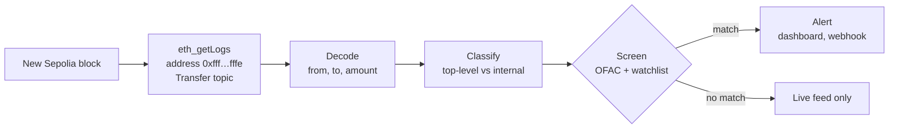

# ETH Flow Monitor

**Real-time monitoring of every native ETH transfer, including transfers made inside smart contracts, using the Transfer logs that Glamsterdam's EIP-7708 adds to Ethereum.**

**[Live demo](https://eth-flow-monitor.vercel.app)** · **[Demo guide](docs/demo-guide.md)** · **[Product Requirements Doc (PDF)](docs/ETH-Flow-Monitor-PRD.pdf)**

ETH Flow Monitor streams every ETH transfer on the Sepolia testnet and screens each one against the OFAC sanctions list and a watchlist. Matches are shown as alerts that an analyst can escalate, mark as reviewed, or dismiss. It was built by Yuchen Zhou as the Glamsterdam project for FinTech-564.

## Why it matters

When ETH moves inside a smart contract, such as a multisig, a smart wallet or a DeFi protocol, Ethereum today records **no log** of it. Exchanges and compliance teams have only two ways to see that ETH: run expensive tracing infrastructure that re-executes every transaction, or buy the data from a large analytics vendor.

[EIP-7708](https://eips.ethereum.org/EIPS/eip-7708) is scheduled for the Glamsterdam upgrade ([EIP-7773](https://eips.ethereum.org/EIPS/eip-7773)). It makes **every ETH transfer emit a standard `Transfer` log**, the same event ERC-20 tokens use, from the system address `0xfff…fffe`. Monitoring that used to need trace nodes becomes an ordinary log subscription. Glamsterdam has been live on Sepolia since October 6, 2026, so this project runs on real network data today.

## What it does

- **Live feed:** every ETH transfer as it happens, labelled **Top-level** (a normal transaction) or **Internal** (made inside a contract, visible only through EIP-7708).
- **Watchlist alerts:** an alert whenever a watched address sends or receives ETH, with an optional minimum amount. Addresses can be added one at a time or by CSV upload.
- **Sanctions screening:** both sides of every transfer are checked against the 87 ETH addresses on the [OFAC SDN list](https://ofac.treasury.gov/specially-designated-nationals-and-blocked-persons-list-sdn-human-readable-lists). Each alert records the list version used, so the decision can be audited later.
- **Alert review:** Escalate, Mark reviewed or False positive, with analyst notes, plus CSV export of an address's transfers.
- **Tx inspector:** for any transaction, compares the logs a tool could see before EIP-7708 with the new ETH Transfer logs.

## How it works



A transaction's own value transfer always produces the **first** 7708 log in that transaction. So a transfer is classified as top-level when it is the first log and matches the transaction's sender, recipient and value. Every other ETH movement happened inside contract execution.

## Two versions

| | Hosted demo (Vercel) | Full local app |
|---|---|---|
| Run it | Open https://eth-flow-monitor.vercel.app | `npm start` → http://localhost:3000 |
| Ingestion | The browser polls a serverless API every 6 s | An always-on ingestor polls every 2 s |
| Storage | Watchlist and alerts saved in each viewer's browser | SQLite database |
| Sanctions list | OFAC snapshot, refreshed on redeploy | Refreshed from OFAC daily (keeps the last good copy if a download fails) |
| Reorgs | Shows only blocks with 1+ confirmation | Detects reorgs and rolls back the affected blocks |
| Alert delivery | Dashboard | Dashboard, webhook, email stub |

On a first visit, the hosted demo adds the most active Sepolia address (the one that received the most ETH transfers in the latest blocks) to the watchlist, so real alerts appear within seconds. Every minute it switches to the busiest receiver of that minute, keeping earlier alerts. **Reset demo** starts it over.

## Quick start (local)

You need [Node.js 24](https://nodejs.org/). No API keys are required: the default RPC is a free public Sepolia endpoint.

```bash
npm install
```

```bash
npm test
```

```bash
npm run smoke
```

```bash
npm start
```

Then open http://localhost:3000. To change settings, copy `.env.example` to `.env`. The settings are the RPC URL, the poll interval, the start block and an optional webhook URL.

| Command | What it does |
|---|---|
| `npm start` | Full local app (ingestor, SQLite and dashboard) on port 3000 |
| `npm run preview:web` | The Vercel version, run locally on port 3001 |
| `npm test` | 34 unit and integration tests |
| `npm run smoke` | Live check: decodes the latest 5 Sepolia blocks and counts ETH transfers |
| `npm run demo` | Sends ETH through a contract to trigger a live sanctions alert (see below) |
| `npm run typecheck` | TypeScript check |

### Live sanctions-alert demo

Real sanctioned addresses almost never transact on a testnet, so the live demo uses one **mock** sanctioned address (`data/mock_sanctions.csv`).

1. Create a throwaway Sepolia wallet, fund it from a Sepolia faucet, and set `DEMO_PRIVATE_KEY` in `.env`. **Never use a wallet that holds real funds.**
2. With the app running, run `npm run demo`. It deploys a 23-byte forwarder contract and sends ETH through it to the mock address.
3. Within about 15 seconds, a sanctions alert appears for the **internal** leg. The script prints a Tx inspector link that shows the before/after-7708 view.

The real SDN addresses of Lazarus Group (8) and Garantex Europe (7) are used only in the replay test, which confirms that all 15 are flagged. The demo never sends ETH to them.

## Project structure

```
src/        core logic: decode, classify, screen, sanctions, ingest (local), scan (hosted), server
api/        Vercel serverless functions: /api/blocks, /api/inspect, /api/sanctions
web/        hosted dashboard (browser polling, localStorage)
public/     local dashboard (server-sent events)
scripts/    smoke test, demo transaction, local preview of the hosted version
test/       vitest suites, including a replay of the 15 Lazarus Group and Garantex addresses
data/       OFAC SDN ETH addresses (snapshot), demo screening set, mock sanctions list
docs/       demo guide, PRD, design specs and implementation plan
```

**Built with:** TypeScript on Node 24, [viem](https://viem.sh), Node's built-in `node:sqlite`, [Fastify](https://fastify.dev), plain HTML/CSS/JavaScript, [vitest](https://vitest.dev), and [Vercel](https://vercel.com) for hosting. Every push to `main` deploys the hosted demo automatically.

## Limitations

- **Testnet only.** It runs on Sepolia, where ETH has no monetary value. Mainnet needs Glamsterdam's mainnet activation, which has no confirmed date yet. After that, switching is a configuration change.
- **History starts at the fork.** Blocks from before Glamsterdam have no EIP-7708 logs.
- **Decision support, not a compliance service.** OFAC states that its address listings are not exhaustive, so a clean result does not prove an address is safe. The tool flags transfers for a human to review. It makes no legal determinations and never acts on funds.
- **Spec still final-reviewing.** EIP-7708 is in Last Call until November 1, 2026. If its log format changes, the decoder will be updated to match.

## Documents

- **[Demo guide](docs/demo-guide.md):** a 2-minute walkthrough of the live demo, and which parts are real and which are mock.
- **[Product Requirements Doc](docs/ETH-Flow-Monitor-PRD.pdf):** problem, goals, personas, requirements, success metrics, user flow and wireframe.
- **[Design specs](docs/superpowers/specs/)** and the **[implementation plan](docs/superpowers/plans/)**: technical design of the local and hosted versions.
